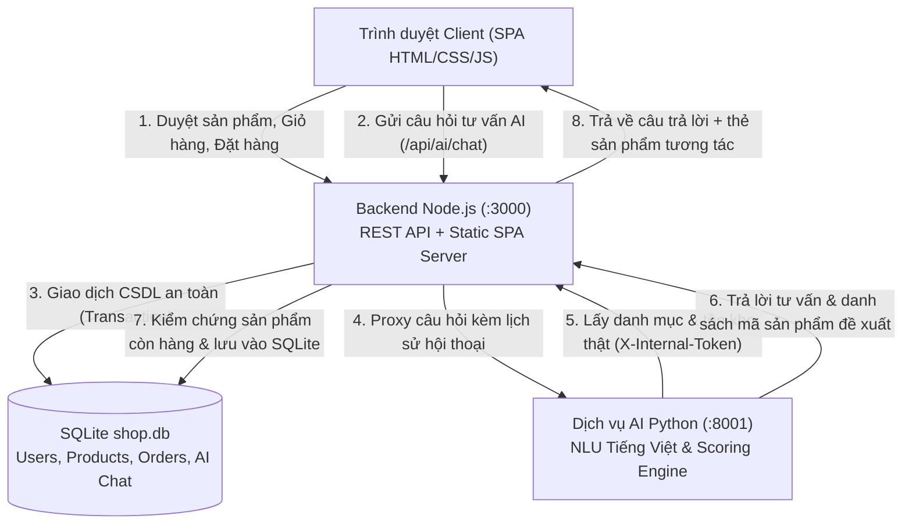

# STRIDEX – Website Bán Giày Thể Thao Tích Hợp Trí Tuệ Nhân Tạo (AI)

> **Đồ án môn học / Khóa luận tốt nghiệp:** Full-stack E-commerce Website tích hợp Trợ lý AI tư vấn giày thông minh.  
> **Phong cách giao diện:** Minimalist Premium Sneaker E-commerce (lấy cảm hứng từ triết lý thiết kế thể thao cao cấp).  
> **Ngôn ngữ & Đơn vị:** 100% Tiếng Việt, tiền tệ VNĐ.

---

## 1. Công nghệ thực tế sử dụng

| Tầng hệ thống | Công nghệ / Thư viện | Vai trò |
| :--- | :--- | :--- |
| **Frontend** | HTML5, CSS3 (Vanilla + Design Tokens), ES6 JavaScript Modules | Giao diện SPA (Single Page Application) phong cách thể thao cao cấp, responsive đa thiết bị, chuẩn accessibility (a11y), quản lý focus trap, modal, drawer, thông báo toast. Không phụ thuộc nặng thư viện UI cồng kềnh. |
| **Backend Chính** | Node.js (v20+ / v22+ built-in modules: `node:http`, `node:sqlite`, `node:crypto`) | Máy chủ REST API, phục vụ tệp tĩnh SPA, kiểm thực xác thực JWT HS256, mã hóa mật khẩu scrypt, quản lý trạng thái giỏ hàng có thẩm quyền, xử lý đặt hàng và giao dịch trong CSDL (DatabaseSync Transaction). |
| **Cơ sở dữ liệu** | SQLite (WAL Mode, Foreign Keys ON) | Lưu trữ người dùng, sản phẩm, biến thể (size, màu, tồn kho), giỏ hàng, đơn hàng, mã giảm giá, hội thoại và tin nhắn của trợ lý AI. Dữ liệu mẫu được gắn cờ `is_demo = 1` riêng biệt. |
| **Dịch vụ AI** | Python 3 (Standard Library: `http.server`, `urllib.request`, `unicodedata`, `re`, `json`) | Module NLU xử lý ngôn ngữ tự nhiên tiếng Việt: trích xuất mục đích (chạy bộ, bóng rổ, đi bộ, dã ngoại...), ngân sách, kích cỡ (size), giới tính; truy vấn danh mục sản phẩm thật qua API nội bộ có khóa bảo mật và thuật toán chấm điểm xếp hạng. |
| **Kiểm thử** | `node:test` (Node.js test runner) & `unittest` (Python) | Kiểm thử tích hợp tự động cho API và kiểm thử đơn vị cho module AI. |

---

## 2. Kiến trúc hệ thống và Luồng dữ liệu



### Nguyên tắc dữ liệu có thẩm quyền (Authoritative Data Source):
- Trình duyệt **chỉ lưu trữ** `variantId` và `qty` trong `localStorage`.
- Mọi giá trị về **đơn giá**, **giá khuyến mãi**, **tổng tiền**, **chiết khấu coupon**, **phí vận chuyển**, và **kiểm tra tồn kho** đều do backend Node.js tính toán và quyết định thông qua endpoint `/api/cart/quote`.
- Trợ lý AI **không được tự bịa ra** sản phẩm hay giá tiền; AI chỉ đề xuất các sản phẩm thực tế có trong hệ thống và backend luôn kiểm chứng lại sự tồn tại cũng như tình trạng còn hàng trước khi hiển thị cho người dùng.

---

## 3. Cài đặt và Hướng dẫn Chạy

### Yêu cầu môi trường
- **Node.js:** phiên bản `>= 20.0.0` (khuyến nghị Node 22+)
- **Python:** phiên bản `>= 3.10` (khuyến nghị Python 3.11 - 3.13)

### Bước 1: Chuẩn bị file môi trường
Sao chép file cấu hình mẫu:
```bash
cp .env.example .env
```
*(Trên Windows PowerShell: `Copy-Item .env.example .env`)*

Các biến môi trường mặc định đã được thiết lập sẵn cho môi trường phát triển cục bộ.

### Bước 2: Khởi động Backend (Node.js)
Mở một cửa sổ terminal và chạy:
```bash
npm start
# Hoặc: node server/index.js
```
Máy chủ web sẽ chạy tại: **`http://localhost:3000`**  
*(CSDL SQLite `database/shop.db` sẽ tự động khởi tạo bảng và nạp dữ liệu mẫu ban đầu nếu trống).*

### Bước 3: Khởi động Dịch vụ AI (Python)
Mở một cửa sổ terminal thứ hai và chạy:
```bash
npm run ai
# Hoặc: python ai-service/app.py
```
Dịch vụ AI sẽ chạy tại: **`http://127.0.0.1:8001`**

### Bước 4: Mở trình duyệt
Truy cập: **[http://localhost:3000](http://localhost:3000)**

---

## 4. Tài khoản Kiểm thử (Demo Accounts)

Hệ thống đã nạp sẵn dữ liệu demo để thuận tiện cho việc trình bày và chấm đồ án:

| Vai trò | Email đăng nhập | Mật khẩu | Chức năng |
| :--- | :--- | :--- | :--- |
| **Quản trị viên (Admin)** | `admin@stridex.local` | `Admin@123` | Truy cập trang Quản trị (`#/admin`), xem Dashboard thống kê doanh thu 7 ngày, quản lý sản phẩm / biến thể tồn kho, cập nhật trạng thái đơn hàng, quản lý mã giảm giá. |
| **Khách hàng (Customer)** | `demo@stridex.local` | `Demo@123` | Xem sản phẩm, đặt hàng, quản lý địa chỉ nhận hàng, lịch sử đơn hàng, danh sách yêu thích. |

*(Người dùng cũng có thể bấm Đăng ký tài khoản mới trực tiếp trên giao diện).*

---

## 5. Danh mục Chức năng đã Triển khai

### Khách hàng (Storefront)
1. **Header & Điều hướng:**
   - Announcement bar thông báo mã ưu đãi và ngưỡng miễn phí ship thật.
   - Menu danh mục: Hàng mới, Nam, Nữ, Thể thao, Giảm giá.
   - Drawer menu trên mobile hỗ trợ đóng mở, focus trap, phím Escape.
   - Tìm kiếm tức thì theo từ khóa (tên giày, danh mục, màu sắc).
   - Badge hiển thị số lượng sản phẩm trong giỏ hàng theo thời gian thực.
2. **Trang chủ:**
   - Hero banner phong cách thể thao tối giản với ảnh độ phân giải cao.
   - Khối điều hướng danh mục dạng tile nổi bật.
   - Grid sản phẩm mới nhất & sản phẩm đang giảm giá.
   - Banner giới thiệu trợ lý AI.
   - Footer thông tin cửa hàng, chính sách giao hàng và các kênh liên hệ.
3. **Danh mục sản phẩm (Shop / Catalog):**
   - Bộ lọc đa tiêu chí: Giới tính, Danh mục, Màu sắc, Size (chỉ hiện size đang còn hàng), Khoảng giá, Trạng thái (còn hàng, giảm giá, hàng mới).
   - Sắp xếp: Mới nhất, Giá tăng dần, Giá giảm dần, Tên A-Z.
   - Drawer bộ lọc riêng biệt và tiện lợi trên thiết bị di động.
   - Hiển thị chip các bộ lọc đang kích hoạt kèm nút xóa nhanh.
4. **Chi tiết sản phẩm (Product Detail Page - PDP):**
   - Thư viện ảnh sản phẩm độ phân giải cao.
   - Lựa chọn màu sắc, chọn size theo biến thể thực tế trong CSDL.
   - Hiển thị chính xác tồn kho theo size được chọn (cảnh báo sắp hết hàng nếu `stock <= 5`, vô hiệu hóa khi hết hàng).
   - Bộ chọn số lượng (Qty Stepper) tuân thủ giới hạn tồn kho và giới hạn tối đa `MAX_QTY_PER_LINE = 5`.
   - Nút Thêm vào giỏ hàng và nút Yêu thích (Wishlist).
   - Sản phẩm liên quan (cùng danh mục/giới tính).
5. **Giỏ hàng & Báo giá thẩm quyền:**
   - Danh sách sản phẩm, ảnh đại diện, màu, size, đơn giá.
   - Điều chỉnh số lượng và xóa sản phẩm.
   - Áp dụng mã giảm giá (VD: mã `WELCOME10`).
   - Tự động tính phí vận chuyển (30.000đ, miễn phí nếu đơn hàng `>= 2.000.000đ`).
   - Cảnh báo tự động nếu tồn kho thay đổi khi đang xem giỏ.
6. **Thanh toán & Đặt hàng (Checkout):**
   - Sử dụng địa chỉ đã lưu trong sổ địa chỉ hoặc nhập địa chỉ mới.
   - Kiểm tra ràng buộc họ tên, số điện thoại Việt Nam hợp lệ.
   - Phương thức thanh toán: COD (Thanh toán khi nhận hàng) hoặc Chuyển khoản ngân hàng.
   - Trừ tồn kho tức thì trong Database Transaction ngay khi đặt hàng thành công.
7. **Tài khoản & Lịch sử đơn hàng:**
   - Đăng ký, Đăng nhập, Đổi mật khẩu.
   - Quản lý sổ địa chỉ giao hàng (Thêm, Xóa, Đặt mặc định).
   - Xem danh sách đơn hàng đã đặt kèm trạng thái tiến trình (Timeline).
   - Khách hàng có thể tự hủy đơn hàng khi đơn đang ở trạng thái `Chờ xác nhận` (pending). Tồn kho của các biến thể trong đơn sẽ tự động được hoàn trả vào CSDL.
8. **Danh sách yêu thích (Wishlist):**
   - Lưu trữ và đồng bộ sản phẩm yêu thích vào tài khoản người dùng trong CSDL.
9. **Trợ lý mua sắm AI (Floating Assistant):**
   - Nút nổi nhỏ gọn ở góc phải dưới, **không tự động bung mở gây che khuất nội dung**.
   - Hỗ trợ câu hỏi gợi ý nhanh (quick chips).
   - Phân tích câu hỏi tiếng Việt: mục đích (chạy bộ, bóng rổ, đi dạo...), ngân sách (VD: "dưới 2.5 triệu", "tầm 2tr"), size chân, giới tính.
   - Ghi nhớ ngữ cảnh đa lượt (Multi-turn conversation).
   - Trả lời chính sách giao hàng, mã giảm giá và hình thức thanh toán từ dữ liệu thật của cửa hàng.
   - Hiển thị thẻ sản phẩm tương tác trực tiếp trong khung chat, dẫn link đến trang chi tiết.
   - Xử lý trạng thái lỗi lịch sự, có nút "Thử lại" khi dịch vụ AI bận hoặc ngắt kết nối.

### Quản trị viên (Admin Dashboard)
1. **Thống kê tổng quan (Overview):**
   - Doanh thu thực tế từ các đơn hàng hợp lệ (không tính đơn đã hủy).
   - Biểu đồ cột trực quan thống kê doanh thu 7 ngày gần nhất.
   - Phân bố số lượng đơn theo từng trạng thái.
   - Danh sách biến thể sắp hết hàng (`stock <= 2`) để quản lý nhập hàng.
2. **Quản lý sản phẩm (Products):**
   - Thêm sản phẩm mới và chỉnh sửa sản phẩm hiện có.
   - Quản lý danh sách biến thể theo màu sắc, kích cỡ và tồn kho.
   - Bật/tắt trạng thái hiển thị (Ẩn / Đang bán).
3. **Quản lý đơn hàng (Orders):**
   - Xem chi tiết từng đơn hàng, người nhận, địa chỉ, sản phẩm trong đơn.
   - Chuyển đổi trạng thái đơn hàng theo quy trình hợp lệ (`pending` → `confirmed` → `shipping` → `delivered` hoặc `cancelled`).
   - Đánh dấu đơn hàng chuyển khoản đã thanh toán (`paid`).
4. **Quản lý người dùng (Users):**
   - Danh sách người dùng, email, số điện thoại, ngày tạo và số lượng đơn đã đặt.
5. **Quản lý mã giảm giá (Coupons):**
   - Tạo mã mới, phần trăm giảm giá, đơn hàng tối thiểu, ngày hết hạn.
   - Kích hoạt hoặc đặt làm mã công khai trên thanh thông báo.

---

## 6. Danh sách API chính

| Phương thức | Endpoint | Quyền hạn | Mô tả |
| :--- | :--- | :--- | :--- |
| `GET` | `/api/config` | Công khai | Lấy cấu hình cửa hàng, phí ship, mã coupon hiển thị |
| `GET` | `/api/products` | Công khai | Lấy danh sách sản phẩm hỗ trợ query tìm kiếm, lọc, sắp xếp |
| `GET` | `/api/products/facets` | Công khai | Lấy danh mục, danh sách màu, size để dựng bộ lọc |
| `GET` | `/api/products/:slug` | Công khai | Chi tiết sản phẩm & sản phẩm liên quan |
| `POST` | `/api/cart/quote` | Công khai | Báo giá giỏ hàng có thẩm quyền, kiểm tra tồn kho & coupon |
| `POST` | `/api/auth/register` | Công khai | Đăng ký tài khoản khách hàng mới |
| `POST` | `/api/auth/login` | Công khai | Đăng nhập và nhận JWT token |
| `GET` | `/api/auth/me` | Người dùng | Lấy thông tin cá nhân |
| `POST` | `/api/addresses` | Người dùng | Thêm địa chỉ giao hàng |
| `POST` | `/api/orders` | Người dùng | Tạo đơn hàng mới (transaction trừ kho) |
| `GET` | `/api/orders` | Người dùng | Lịch sử đơn hàng của người dùng |
| `GET` | `/api/orders/:code` | Người dùng/Admin | Chi tiết đơn hàng |
| `POST` | `/api/orders/:code/cancel` | Người dùng | Hủy đơn hàng đang chờ xác nhận (hoàn kho) |
| `GET/POST` | `/api/wishlist[/:id]` | Người dùng | Quản lý danh sách yêu thích |
| `POST` | `/api/ai/chat` | Công khai/Người dùng | Tư vấn mua sắm giày qua module AI |
| `GET` | `/api/admin/stats` | Admin | Số liệu thống kê doanh thu và tồn kho |
| `GET/POST` | `/api/admin/products` | Admin | Quản lý sản phẩm và biến thể |
| `PUT` | `/api/admin/orders/:code/status` | Admin | Chuyển trạng thái đơn hàng |

---

## 7. Hướng dẫn Chạy Kiểm thử Tự động (Tests)

Hệ thống được trang bị bộ kiểm thử tự động toàn diện:

### 1. Kiểm thử tích hợp Backend & API (Node.js Test Runner)
Chạy lệnh:
```bash
npm test
```
*Kết quả kiểm thử 12 kịch bản tích hợp: cấu hình, danh mục, giỏ hàng báo giá, đăng ký, đăng nhập JWT, địa chỉ, đặt hàng trừ kho, hủy đơn hoàn kho, thống kê admin và trợ lý AI.*

### 2. Kiểm thử đơn vị Module AI (Python Unittest)
Chạy lệnh:
```bash
npm run test:ai
```
*Kết quả kiểm thử 6 kịch bản NLU: nhận diện mục đích, phân tích ngân sách đa dạng, kích cỡ, ngữ cảnh đa lượt, thuật toán chấm điểm và phản hồi chính sách.*

---

## 8. Giới hạn và Hướng phát triển

1. **Cổng thanh toán trực tuyến:** Hiện tại hệ thống hỗ trợ COD và Chuyển khoản ngân hàng (xác nhận thủ công bởi admin). Hướng phát triển tiếp theo là tích hợp cổng thanh toán trực tuyến (VNPAY, MoMo, ZaloPay) khi có thông tin định danh doanh nghiệp.
2. **Mô hình học máy mở rộng:** Module AI hiện tại sử dụng NLU luật kết hợp engine chấm điểm theo vector đặc trưng sản phẩm. Có thể mở rộng kết nối LLM (Gemini API / OpenAI) thông qua cấu hình biến môi trường khi triển khai trên production có API key.
3. **Cơ sở dữ liệu phân tán:** Hệ thống hiện sử dụng SQLite WAL mode hiệu năng cao (xử lý hàng nghìn truy vấn/giây trên một node). Khi mở rộng quy mô lớn có thể chuyển đổi sang cụm MySQL/PostgreSQL cho dữ liệu nghiệp vụ và MongoDB cho lịch sử hội thoại AI.
